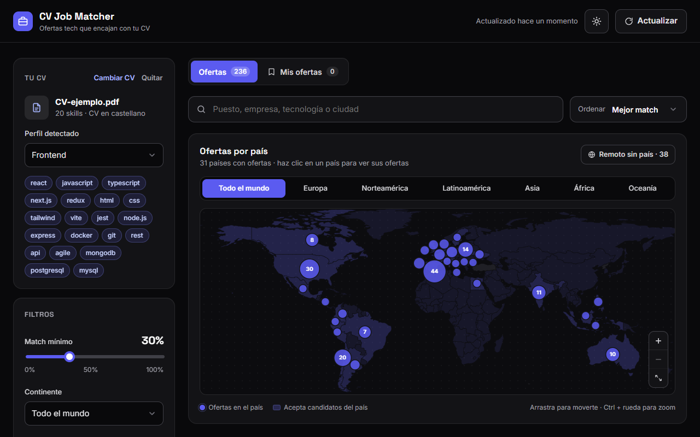
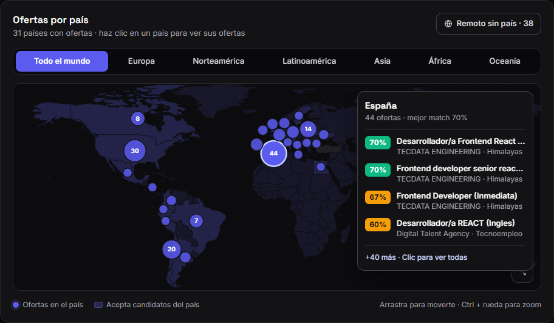
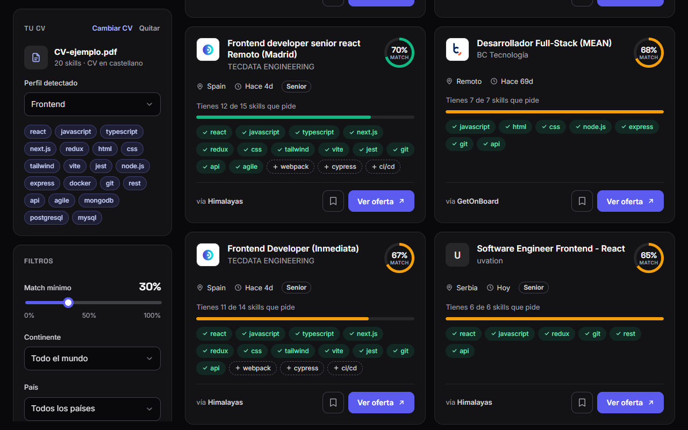
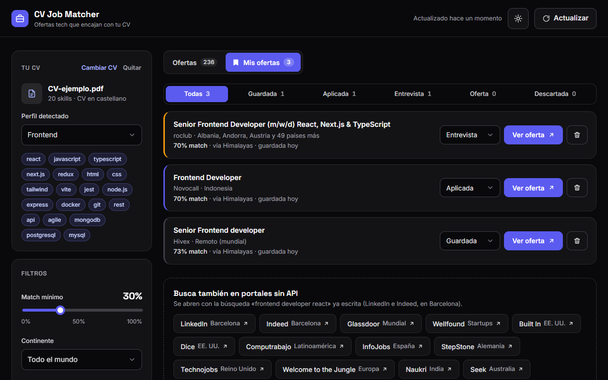
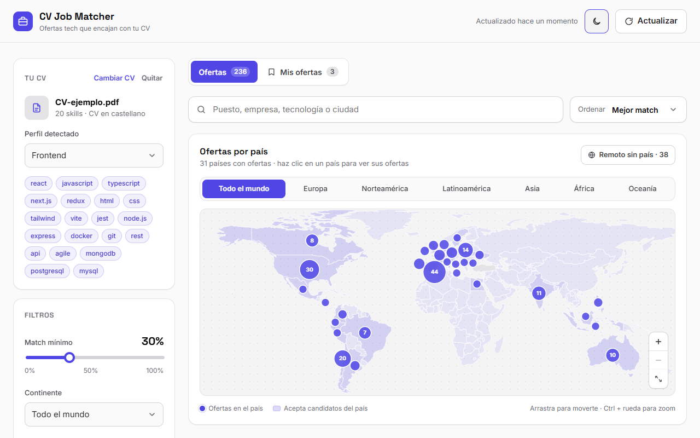
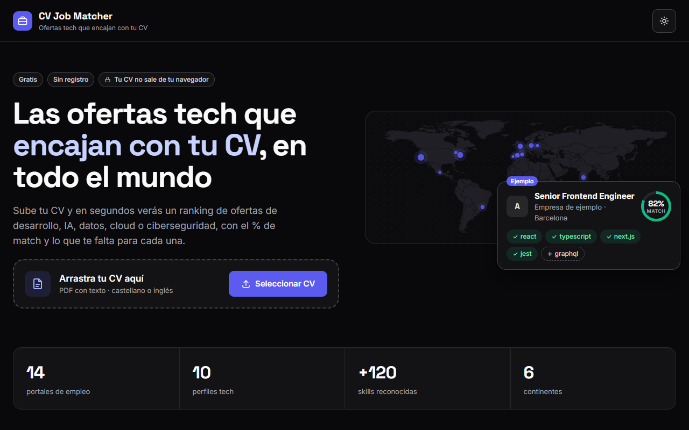
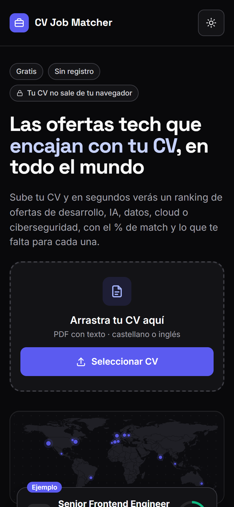
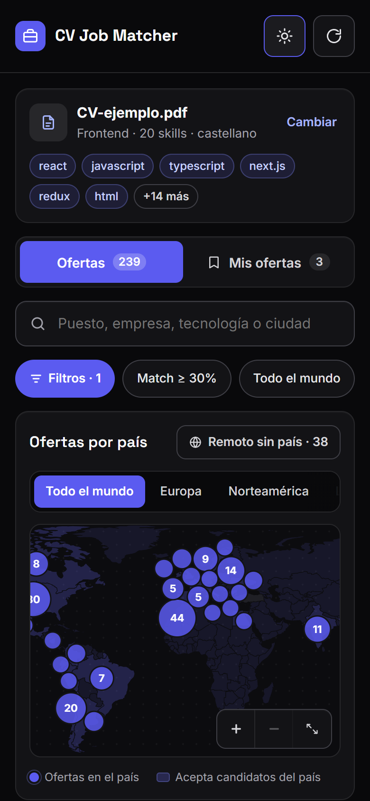
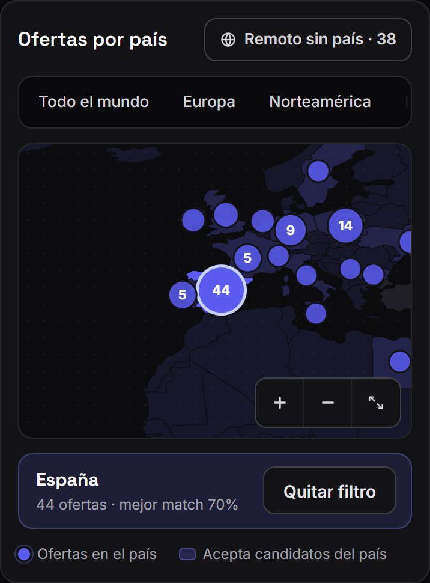

# CV Job Matcher

Sube tu CV en PDF y obtén un ranking de ofertas tech de todo el mundo ordenadas por % de match,
con las skills que tienes y las que te faltan para cada una.

**En producción:** https://frontend-jobs-app-psi.vercel.app

▶️ **[Ver el vídeo de demostración (1 min)](docs/demo.mp4)**: subir el CV, resultados, mapa, búsqueda, Mis ofertas y modo claro.



## Capturas

| Mapa: pasa el ratón por un país | Tarjetas: lo que tienes y lo que te falta |
|---|---|
|  |  |

| Mis ofertas: seguimiento de candidaturas | Modo claro |
|---|---|
|  |  |

**Portada**



**Móvil**

<p>
  
  
  
</p>

> Las capturas se generan con `npm run screenshots` (ver más abajo) y muestran un CV de ejemplo.

## Qué hace

- **Lee el CV en el navegador** (pdf.js): el PDF no se envía a ningún servidor.
- **Detecta tu perfil** (10 perfiles tech: Frontend, Backend, Full Stack, Móvil, IA/ML, Datos,
  DevOps/Cloud, QA, Ciberseguridad, Sistemas/Soporte IT), tus skills (+120), tu idioma, país y ciudad.
  Rechaza CVs que no son del sector tecnológico.
- **Busca en 14 fuentes** con datos públicos: Adzuna, Himalayas, Hacker News "Who is hiring?",
  RemoteOK, Remotive, We Work Remotely, Working Nomads, Jobicy, NoFluffJobs, GetOnBoard,
  Landing.jobs, Arbeitnow, Tecnoempleo y Manfred. Más enlaces de búsqueda a portales sin API
  (LinkedIn, Indeed, Glassdoor, InfoJobs…).
- **Mapa mundial interactivo** (SVG propio): burbujas por país, zoom por continente y país,
  ventana con las mejores ofertas al pasar el ratón.
- **Filtros**: continente, país, nivel (junior → lead), salario mínimo anual en €, fecha,
  fuente y match mínimo. Paginación, modo claro/oscuro y diseño adaptado a móvil.
- **Skills que más te piden** y no tienes, sobre las ofertas que estás viendo.
- **Mis ofertas**: guarda ofertas y sigue cada candidatura (aplicada, entrevista, oferta…).

## Arrancar en local

```bash
npm install
cp .env.example .env.local   # y rellena las claves de Adzuna (opcional)
npm run dev                  # http://localhost:5173
```

| Script | Qué hace |
|---|---|
| `npm run dev` | Servidor de desarrollo (con los proxies) |
| `npm run build` / `npm run preview` | Build de producción / servirla en local (con los proxies) |
| `npm run lint` | oxlint |
| `npm run test:e2e` | Pruebas en un Chrome real: coherencia de números del mapa, mis ofertas, filtros, móvil |
| `npm run screenshots` | Regenera las capturas de `docs/screenshots/` |
| `npm run video` | Graba `docs/demo.mp4` (demo guiada con cursor y subtítulos; usa `ALLOW_ADZUNA=1`) |
| `npm run generate:geo` | Regenera `src/data/` (contornos y países) |

Las pruebas y capturas usan tu Chrome instalado (`CHROME_PATH` para otra ruta) y, por defecto,
`BASE_URL=http://localhost:5173/` (con `npm run dev` arrancado). Adzuna se bloquea en las pruebas
para no gastar cuota; `ALLOW_ADZUNA=1` lo permite (recomendado para las capturas).

## Variables de entorno

| Variable | Dónde | Para qué |
|---|---|---|
| `ADZUNA_APP_ID`, `ADZUNA_APP_KEY` | `.env.local` (local) y variables del proyecto en Vercel | Claves de [Adzuna](https://developer.adzuna.com/). Sin prefijo `VITE_`: las añade el proxy y **nunca llegan al navegador**. |
| `VITE_ADZUNA_ENABLED` | opcional | `false` desactiva Adzuna. |

## Proxies

Algunas fuentes no permiten CORS o necesitan claves, así que pasan por `/proxy/...`:

- **Local:** proxy de Vite (`vite.config.js`), funciona con `npm run dev` y `npm run preview`.
- **Vercel:** reglas `routes` de `vercel.json` (las claves de Adzuna se inyectan en el servidor).

## Estructura

```
src/
├── components/   UI: Home (portada), CVUploader, JobCard, JobMap, Filters, SearchBar, Pagination…
├── hooks/        useCV (CV y perfil), useJobs (carga progresiva y match), useSavedJobs, useTheme
├── services/     cvService (PDF, skills, perfil, match), jobService (fuentes), geoService (ubicaciones),
│                 jobMeta (nivel, salario en €, antigüedad)
└── data/         countries.js y worldMap.js (generados por scripts/generate-geo.mjs)
scripts/e2e/      pruebas e2e y capturas (puppeteer-core + Chrome instalado)
docs/screenshots/ capturas del README · docs/demo.mp4 vídeo de demostración
```

Para añadir una skill: `SKILL_GROUPS` y `SKILL_ALIASES` en `src/services/cvService.js`.

## Desplegar

El repositorio está conectado a Vercel:

- **Push a `main`** → despliegue a producción automático.
- **Push a cualquier otra rama** (o pull request) → despliegue de vista previa con su propia URL.

También se puede desplegar a mano con `vercel deploy --prod`.

Datos geográficos: Natural Earth (dominio público) y world-countries (ODbL).
